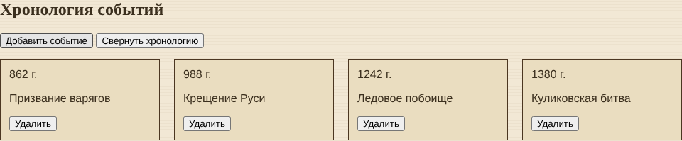
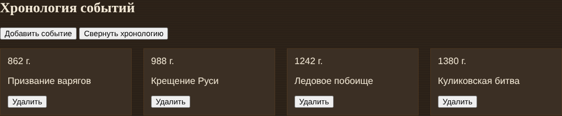
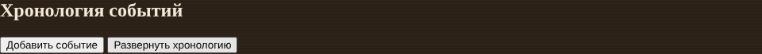

# Лабораторная работа №5. DOM и взаимодействие с элементами страницы

Страница «О себе», вариант 19 - «Историк и реконструктор».
В этой работе на страницу из ЛР №4 добавлена секция «Хронология событий» и интерактив на JavaScript.

## Задача по варианту
Хронология событий: горизонтальные карточки (дата, событие, кнопка «Удалить»).
Кнопка «Добавить событие» создаёт карточку, кнопка «Свернуть хронологию» скрывает блок, есть переключение темы и обработка ошибок.

## Что сделано
- поиск элементов через `getElementById` (кнопки), `querySelector` (контейнер карточек), `querySelectorAll` (подсчёт карточек)
- кнопка «Добавить событие» - спрашивает год и событие через `prompt` и создаёт карточку через `createElement` и `appendChild`
- кнопка «Удалить» в каждой карточке - удаляет её через `remove()`
- изменение текста (`textContent`), атрибутов (`setAttribute` для `datetime` и `data-id`) и классов (`classList`)
- кнопка «Свернуть хронологию» - добавляет/убирает класс `hidden`, текст кнопки меняется на «Развернуть хронологию»
- кнопка «Сменить тему» - переключает класс `theme-dark` у `<body>`, цвета меняются через CSS-переменные
- обработка ошибок - если элемент не найден, в консоли пишется «Элемент не найден: ...» и скрипт дальше не выполняется; пустой ввод и отмена в `prompt` тоже проверяются

## Сохранение в localStorage
- `timelineEvents` - список событий, сохраняется при добавлении и удалении карточки
- `theme` - выбранная тема (`light` или `dark`), сохраняется при переключении

При загрузке страницы данные читаются из localStorage, карточки и тема восстанавливаются.
Если сохранённых событий нет, показываются 3 стартовых: 862, 988 и 1242 год.

## Код из ЛР №4
Код из прошлой работы остался в `script.js`: при открытии страницы спрашивается имя, выводится приветствие и расчёты по возрасту артефактов (alert и консоль).

## Как это выглядит

Светлая тема:

Тёмная тема:

Хронология свёрнута:

## Отладка
Ошибки смотрела в консоли браузера (F12), сохранённые данные - во вкладке Application → Local Storage.

## Файлы
- `index.html` - страница
- `style.css` - стили
- `script.js` - скрипт
- `images/` - картинки
- `screenshots/` - скриншоты
